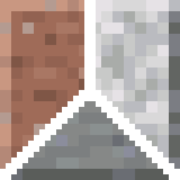

# MoreBricks

**Granite, diorite and andesite bricks, with stairs, slabs and walls.**

## About

Minecraft has polished granite, diorite and andesite, but no bricks to build with. MoreBricks adds
them as full vanilla-style block sets that look and work like stone bricks.

- **12 new blocks**: bricks, stairs, slabs and walls for each stone.
- **Vanilla recipes**: crafted like other brick sets, and every shape can be cut in a stonecutter.
- **Fits right in**: listed in the Building Blocks tab next to each polished stone, and part of the
  vanilla `stairs`, `slabs` and `walls` tags, so walls connect and other mods see them correctly.
- **Lightweight**: just blocks, no config and no extra dependencies besides Fabric API on Fabric.

## Blocks

Each of granite, diorite and andesite gets four blocks:

| Block | Recipe |
|---|---|
| Bricks | 4 polished stone in a 2×2 → 4 bricks |
| Brick Stairs | 6 bricks → 4 stairs |
| Brick Slab | 3 bricks → 6 slabs |
| Brick Wall | 6 bricks → 6 walls |

In a stonecutter, any of these can be made from the raw stone, the polished stone or the bricks.

## Download

Get it from [Modrinth](https://modrinth.com/mod/morebricks),
[CurseForge](https://www.curseforge.com/minecraft/mc-mods/morebricks-granite-diorite-andesite-bricks) or
[GitHub releases](https://github.com/PunJarrr/MoreBricks/releases). Pick the file for your Minecraft
version and mod loader.

| Minecraft | Fabric | NeoForge |
|---|:-:|:-:|
| 26.3 | ✓ | ✓ |
| 26.2 | ✓ | ✓ |
| 26.1 – 26.1.2 | ✓ | ✓ (26.1.2) |
| 1.21.11 | ✓ | ✓ |
| 1.21.9 – 1.21.10 | ✓ | ✓ (1.21.10) |
| 1.21.6 – 1.21.8 | ✓ | ✓ (1.21.8) |
| 1.21.5 | ✓ | ✓ |
| 1.21.4 | ✓ | ✓ |
| 1.21 – 1.21.1 | ✓ | ✓ |
| 1.20.5 – 1.20.6 | ✓ | ✓ (1.20.6) |
| 1.20.3 – 1.20.4 | ✓ | ✓ (1.20.4) |
| 1.20 – 1.20.1 | ✓ | — |

On Fabric, [Fabric API](https://modrinth.com/mod/fabric-api) is also needed.

## FAQ

**Does it need to be on the server and the client?**
Yes. Install it on both, like any mod that adds blocks.

**Can I use it in my modpack?**
Yes, go ahead. No need to ask.

**Can I remove it from an existing world?**
The bricks will disappear from the world, so back up first.

**Will there be more blocks?**
Mossy, cracked and chiseled versions are planned. Ideas are welcome in the
[issue tracker](https://github.com/PunJarrr/MoreBricks/issues).

## Contributing

Bug reports, ideas and pull requests are welcome on the
[issue tracker](https://github.com/PunJarrr/MoreBricks/issues). To build the mod or change its code,
see [CONTRIBUTING.md](CONTRIBUTING.md).

## Credits

The granite, diorite and andesite brick textures come from the [Vanilla Tweaks](https://vanillatweaks.net/)
resource pack, used under the [Vanilla Tweaks terms](https://vanillatweaks.net/terms/).
See [credits.txt](credits.txt), which is also included in every jar.

## License

The code is licensed under [MIT](LICENSE). The Vanilla Tweaks textures stay under the Vanilla Tweaks terms.
